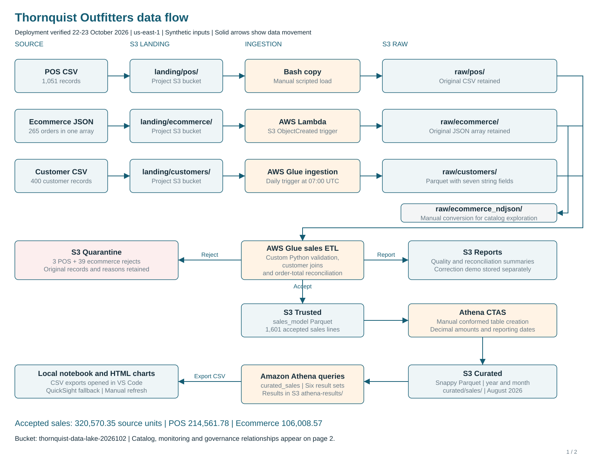

# Thornquist Outfitters Data Lake

AWS data engineering project integrating POS sales, ecommerce orders and customer records through S3 Landing, Raw, Trusted and Curated zones. The verified reporting week is **24–30 August 2026**. Sources are synthetic instructor-provided data.

## Results

| Measure | Verified result |
| --- | ---: |
| Customers accepted | 400 |
| POS records accepted / quarantined | 1,048 / 3 |
| Ecommerce orders accepted / quarantined | 226 / 39 |
| Accepted sales lines | 1,601 |
| Total accepted sales | 320,570.35 |
| POS / ecommerce sales | 214,561.78 / 106,008.57 |

Amounts use source monetary units; the dataset supplies no currency code. Rejection reasons overlap for one ecommerce order.

## Start here

**To reproduce the complete pipeline in a fresh Learner Lab session, use [the clean-lab runner](reproduction/clean_lab/README.md).** It provisions the isolated resources, runs all three ingestion paths, demonstrates bad-record rejection and correction, creates Curated sales, runs the business queries and saves evidence. The files in `ingestion/`, `transform/`, `queries/` and `infrastructure/` also document the individual components of the original deployment; `infrastructure/setup_s3.py` is an optional S3-only bootstrap, not a prerequisite for the full runner.

- [Technical report (PDF)](docs/Thornquist_Technical_Report.pdf) · [Editable Word report](docs/Thornquist_Technical_Report.docx)
- [Architecture (two-page PDF)](architecture/Thornquist_Architecture.pdf) · [Editable draw.io](architecture/Thornquist_Architecture.drawio)
- [Deployment and reproduction guide](docs/deployment.md)
- [Fresh Learner Lab runner](reproduction/clean_lab/README.md) and [runbook](reproduction/clean_lab/DEMO_RUNBOOK.md)
- [Schema and data quality](docs/schema_and_quality.md)
- [Governance controls and limitations](governance/governance_controls.md)
- [Monitoring and automation](docs/monitoring_and_automation.md)
- [Evidence index](evidence/INDEX.md)



The original deployment and the isolated clean-session rehearsal are separate runs. The original deployment uses the account and bucket below. On 23 October 2026, we completed an isolated rehearsal in `thornquist-clean-470551642447-rehearsal01` with the same account and a separate catalog database, `tq_clean_rehearsal01`. The run exercised S3-event ecommerce ingestion, a customer Glue job, Raw and Trusted Athena queries, an actual bad-record rejection followed by a corrected run, Curated CTAS, and six business queries. We showed catalog tables across all four zones in AWS. The repo runner includes the retry/queuing improvements and explicitly records a Landing POS definition and count check.

## Fresh Learner Lab reproduction

In a new Learner Lab session, open CloudShell in `us-east-1`, obtain this repository, and work from `reproduction/clean_lab/`. Run the preview and then the deployment with a fresh label:

```bash
python3 clean_lab.py --expected-account 470551642447 --run-label recording01 --enable-schedules
python3 clean_lab.py --expected-account 470551642447 --run-label recording01 --enable-schedules --apply
```

Replace the account number with the signed-in lab account. The script uses that account's existing `LabRole`, creates an isolated bucket and Glue database, runs ingestion and the bad/corrected Glue quality gate, verifies catalog and Athena counts, creates Curated Parquet, and writes a run evidence ZIP. See the linked runner README for role/workgroup prerequisites, resume behavior, expected results and the recording sequence. The `rehearsal01` run already completed this pipeline on 23 October; its evidence ZIP was downloaded from CloudShell.

| Zone | S3 prefix | Glue/Athena catalog coverage |
| --- | --- | --- |
| Landing | `landing/pos/`, `landing/ecommerce/`, `landing/customers/` | `landing_pos` is explicitly defined over the unchanged CSV; the JSON array and customer CSV remain as received |
| Raw | `raw/pos/`, `raw/ecommerce_ndjson/`, `raw/customers/` | `raw_pos`, `raw_ecommerce_ndjson`, `raw_customers` |
| Trusted | `trusted/` | `trusted_customers`, `trusted_pos_sales`, `trusted_ecommerce_orders`, `trusted_sales_model` |
| Curated | `curated/sales/` | `curated_sales`, created by Athena CTAS with year/month partitions |

Our AWS run showed catalog tables across all four zones. In another deployment, use [the Landing DDL](queries/09_landing_pos_catalog.sql) only if the table is absent, and [the count query](queries/09_landing_pos_count.sql) to check for 1,051 source rows. Catalog inspection does not require replaying sales ETL.

## Repository structure

| Folder | Contents |
| --- | --- |
| `data/` | Three unchanged source datasets |
| `ingestion/` | Original-deployment POS copy, ecommerce Lambda, customer Glue and manual NDJSON catalog helper |
| `transform/` | Glue sales ETL with custom quality checks |
| `infrastructure/` | Optional guarded S3-only bootstrap for a fresh bucket; the full runner does not require it |
| `reproduction/clean_lab/` | Canonical fresh-lab end-to-end runner, original inputs, SQL, matching Glue/Lambda scripts, checks and runbook |
| `queries/` | Curated CTAS, validation and five numbered business questions |
| `analytics/` | Executed notebook, HTML charts and six result CSVs |
| `governance/` | Verified policy snapshots and clearly marked proposed analyst controls |
| `monitoring/` | Read-only test of the deployed Glue failure rule |
| `architecture/` | Diagram PDF, SVGs and editable source |
| `docs/` | Report, deployment guide and focused supporting documentation |
| `tests/` | Local checks of the retained ETL and supplied datasets |
| `evidence/` | Verification index, local test results and captured filter-test text |

## Deployed environment

- Account: `470551642447`; region: `us-east-1`.
- Bucket: `thornquist-data-lake-2026102`; catalog database: `thornquist_outfitters`.
- Lambda: `thornquist-ingest-ecommerce`; Glue jobs: `thornquist-customer-ingestion`, `thornquist-sales-etl`.
- Curated table: `thornquist_outfitters.curated_sales`.
- Existing `LabRole` is reused under AWS Academy restrictions. No credentials are stored here.

POS ingestion is a manual Bash copy. Ecommerce uses an S3 ObjectCreated trigger and preserves the original JSON array. Customer CSV ingestion writes Raw Parquet. The sales ETL validates, joins and flattens records into Trusted Parquet, with rejects and reconciliation reports stored separately. Athena CTAS produces Snappy Parquet partitioned by year and month.

Four crawler schedules and the customer job schedule are configured. The original customer job ran automatically from `thornquist-customer-ingestion-daily` at 07:00 UTC on 23 October 2026 and succeeded (run `jr_4d3cb3e1439b61f099dc644469422d22a6ced6c7537045b7ab34a6a40a891b8a`). The trigger was later restarted and confirmed `ACTIVATED` with `cron(0 7 * * ? *)`. The schedules are independent timers. We run ecommerce NDJSON conversion, sales ETL, Curated CTAS and notebook refresh as explicit pipeline steps. [Scheduling and monitoring details](docs/monitoring_and_automation.md).

We tested the notification paths in the original deployment. A controlled CloudWatch `set-alarm-state` transition sent an alarm email, and an intentionally failed customer Glue run sent a failure email through EventBridge and SNS. The alarm test establishes delivery for a forced transition, not detection of a real Lambda error. The failed Glue run used an intentionally missing test input, not a production source failure.

## Five business questions

| # | Question | SQL | Visualization |
| --- | --- | --- | --- |
| 1 | How do daily POS and ecommerce sales compare? | [Daily](queries/01_daily_sales.sql) | chart_1 |
| 2 | Which regions lead by channel? | [Regions](queries/02_regional_sales.sql) | chart_2 |
| 3 | Which products and categories lead sales? | [Products](queries/03a_top_products.sql), [Categories](queries/03b_category_sales.sql) | chart_3, chart_4 |
| 4 | How do customer loyalty segments differ? | [Loyalty](queries/04_loyalty_sales.sql) | chart_5 |
| 5 | Which stores lead POS sales? | [Stores](queries/05_store_sales.sql) | chart_6 |

[Open the executed notebook](analytics/Thornquist_Sales_Analytics.ipynb), or download [the HTML dashboard](analytics/Thornquist_Sales_Analytics.html) and open it in a browser. We built these visualizations from six exported Athena result sets because Learner Lab denied QuickSight access. Keep the notebook beside its six CSV files when running it. Category mapping is derived at query time; [coverage and provenance](docs/category_mapping.md).

## Local verification

From the repository root, use Python 3.10 or later:

```bash
python3 -m pip install -r requirements.txt
python3 -m pytest -q
```

These local tests exercise pure Python ETL logic and the supplied sample files. The AWS rehearsal and notification tests described above are separate execution evidence. Glue runtime dependencies are supplied by AWS and are not installed through this requirements file.

## Team

| Member | Contribution |
| --- | --- |
| Alahi | Foundation design, source data and documentation coordination |
| Justin | Original ingestion, transformation and quality logic |
| Seyi | Deployment adaptation, Athena/Curated analytics, visualization, scheduling, monitoring and integration verification |

Original transformation credit is retained in the adapted script. See [responsibility matrix](docs/team_responsibilities.md).
